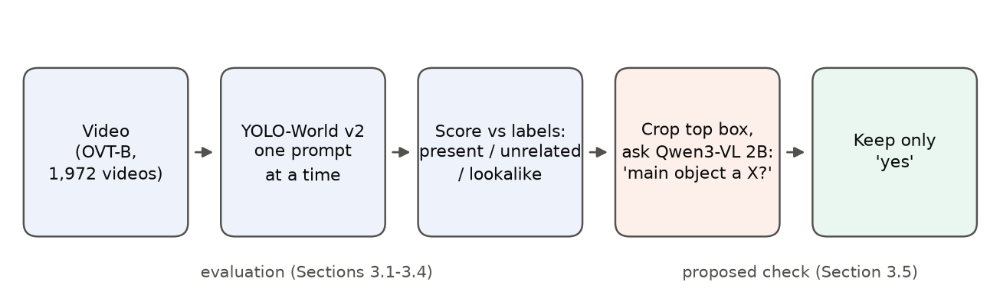
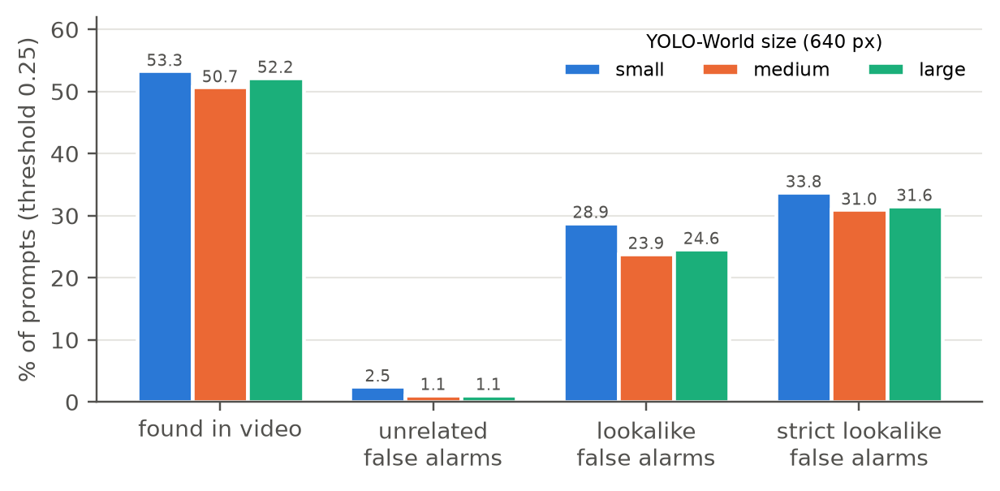
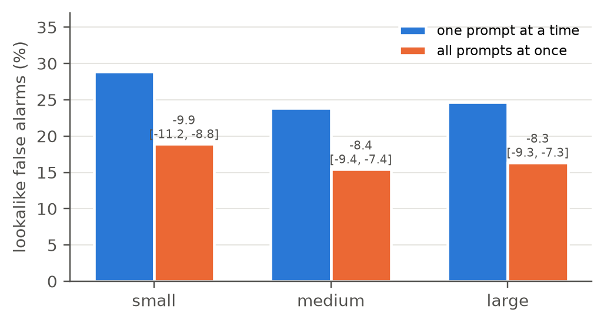
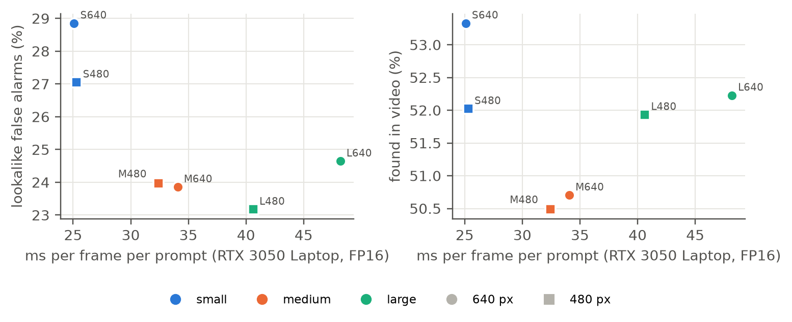
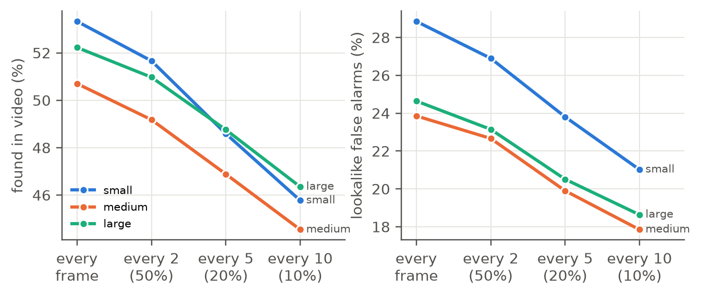
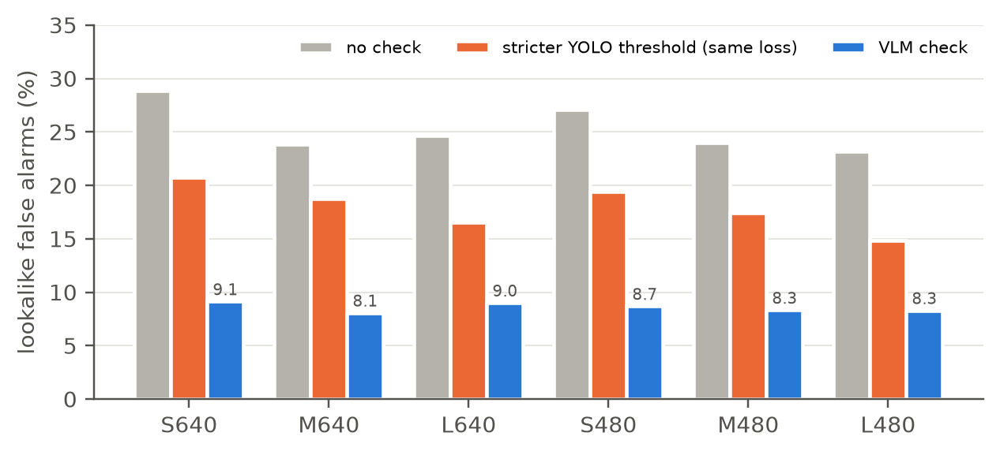
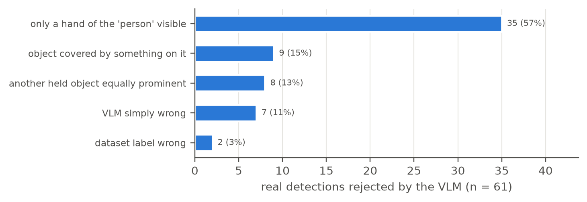
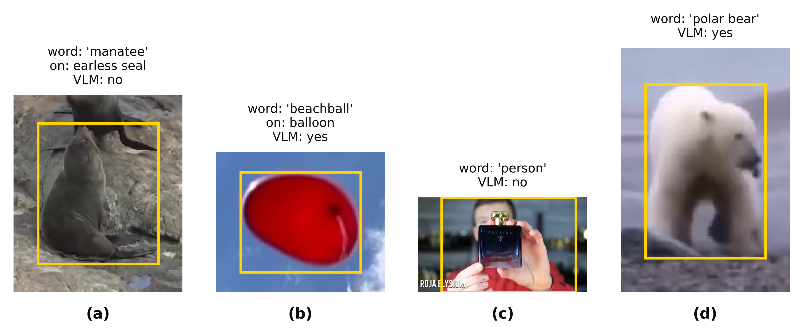

<div align="center">

# Towards Reliable Text-Based Video Search

### Evaluating Open-Vocabulary Detectors and VLM Verification

**Aman Hanspal** &nbsp;·&nbsp; **Dr. Gargi Phadke**

<sub>Code, frozen test sets and results accompanying the manuscript (2026)</sub>

<br>

<a href="https://docs.ultralytics.com/models/yolo-world/"></a>
<a href="https://huggingface.co/Qwen/Qwen3-VL-2B-Instruct"></a>
<a href="https://github.com/Coo1Sea/OVT-B-Dataset"></a>
<a href="https://www.nvidia.com/en-in/geforce/laptops/30-series/"></a>
<a href="LICENSE"></a>
<a href="LICENSE-DATA.md"></a>
<a href="https://doi.org/10.5281/zenodo.23598399"></a>

<br><br>

[**Overview**](#overview) &nbsp;·&nbsp; [**Results**](#main-results) &nbsp;·&nbsp; [**Figures**](#figures) &nbsp;·&nbsp; [**Repository**](#repository-layout) &nbsp;·&nbsp; [**Reproduce**](#reproducing) &nbsp;·&nbsp; [**Citation**](#citation)

</div>

<br>

<table>
<tr><td align="center">

<br>
<sub><b>Fig. 1</b> &nbsp;Each video is searched one word at a time. Detections are scored against the labels with present,
unrelated and lookalike words; the proposed check crops the strongest box of each fired word and asks a small VLM a
yes/no question, keeping only "yes" answers.</sub>
</td></tr>
</table>

## Overview

Can open-vocabulary object detectors act as trustworthy video search engines on a low-memory GPU (4 GB)?
A search engine has to:

1. **find** objects that are in a video, and
2. **stay silent** about objects that are not.

We measure both, using present, easy-absent (unrelated) and hard-absent (lookalike) text queries, and test whether
a vision-language model (VLM) can verify detections and remove lookalike false alarms.

> In the code and file names, `easy_absent` = **unrelated** words and `hard_absent` = **lookalike** words (the terms
> used in the paper).

| Component | Used in this study |
|---|---|
| Detector | YOLO-World v2 (small / medium / large), via Ultralytics, FP16 |
| Dataset | OVT-B: 1,972 of 1,973 videos, 1,053 categories (see `DATA.md`) |
| Search words | 7,808 present, 3,944 unrelated, 3,944 lookalike (frozen before any detector run) |
| Verifier | Qwen3-VL 2B instruct (`qwen3-vl:2b-instruct`), run locally through Ollama |
| Hardware | RTX 3050 Laptop GPU, 4 GB VRAM, power-limited to 30 W in every run |

## Main results

Medium model, 640 px, score threshold 0.25, one search word at a time:

| Measure | Value |
|---|:---:|
| Present objects found somewhere in the video | **50.7%** |
| False alarms for **unrelated** words (e.g. "violin" in a farm video) | **1.1%** |
| False alarms for **lookalike** words (e.g. "duck" in a penguin video) | **23.9%** |
| Lookalike false alarms that sit on a real object of another kind | **93–95%** (all six settings) |
| Lookalike false alarms hidden when all words are asked at once | **8.4 points** (about a third) |
| Lookalike false alarms after the VLM check | **8.1%** (stricter threshold, same loss: 18.7%) |
| Real detections the VLM wrongly rejects | **10.2%** (clear VLM mistakes: 1.2%) |

> [!NOTE]
> A larger model, a stricter threshold, 480 px input or processing only every 10th frame do **not** remove lookalike
> false alarms. The VLM check brings them to 8–9% in **all six** detector settings. Every number here is recomputed
> from the files in this repository by `scripts/make_figures.py` (see `paper_figures/check.md`).

### Table 1 &nbsp;·&nbsp; All six single-word settings

<sub>Threshold 0.25, FP16. FA = false alarms (% of absent words that fire). "On real object" = share of lookalike false
alarms whose box sits on a labelled object of another kind. Source: <code>paper_figures/table1_main.csv</code>.</sub>

| Setting | ms / frame / word | Found in video | Frame hit | Unrelated FA | Lookalike FA | Strict lookalike FA | On real object | Lookalike FA after VLM |
|:---|---:|---:|---:|---:|---:|---:|---:|---:|
| Small 640 | 25.1 | 53.3 | 39.1 | 2.5 | 28.9 | 33.8 | 94.7 | 9.1 |
| Small 480 | 25.3 | 52.0 | 38.5 | 2.6 | 27.1 | 31.9 | 94.2 | 8.7 |
| **Medium 640** | **34.1** | **50.7** | **38.5** | **1.1** | **23.9** | **31.0** | **94.3** | **8.1** |
| Medium 480 | 32.4 | 50.5 | 38.8 | 1.2 | 24.0 | 30.4 | 94.2 | 8.3 |
| Large 640 | 48.2 | 52.2 | 40.5 | 1.1 | 24.6 | 31.6 | 92.8 | 9.0 |
| Large 480 | 40.6 | 51.9 | 40.5 | 1.2 | 23.2 | 30.1 | 94.3 | 8.3 |

## Figures

<sub>All figures are generated from the raw result files by <code>scripts/make_figures.py</code>; PNG and PDF versions
are in <code>paper_figures/</code>.</sub>

<table>
<tr>
<td width="50%" align="center" valign="top">

<br>
<sub><b>Fig. 2</b> &nbsp;Main result. Unrelated words almost never fire; lookalike words fire for about a quarter of
videos, for every model size.</sub>
</td>
<td width="50%" align="center" valign="top">

<br>
<sub><b>Fig. 3</b> &nbsp;Asking all words at once hides about a third of lookalike false alarms (paired difference,
95% interval).</sub>
</td>
</tr>
</table>

<table>
<tr><td align="center">

<br>
<sub><b>Fig. 4</b> &nbsp;Speed against lookalike false alarms (left) and objects found (right). Cheaper settings change
speed but do not reduce lookalike false alarms.</sub>
</td></tr>
</table>

<table>
<tr><td align="center">

<br>
<sub><b>Fig. 5</b> &nbsp;Keeping every k-th frame. Objects found and lookalike false alarms fall together: frame skipping
is a speed lever, not a fix for lookalikes.</sub>
</td></tr>
</table>

<table>
<tr><td align="center">

<br>
<sub><b>Fig. 6</b> &nbsp;Lookalike false alarms without a check, with a stricter detector threshold that loses the same
share of real detections, and with the VLM check, for all six settings.</sub>
</td></tr>
</table>

<table>
<tr><td align="center">

<br>
<sub><b>Fig. 7</b> &nbsp;Why the check rejected real detections (medium 640, all 61 rejections, hand-checked).</sub>
</td></tr>
</table>

<table>
<tr><td align="center">

<br>
<sub><b>Fig. 8</b> &nbsp;Examples (yellow = detector box): "manatee" on a fur seal, rejected by the check; "beachball" on a
balloon, accepted; a real "person" holding a bottle, rejected because the box shows mainly a hand; a real polar bear,
accepted.</sub>
</td></tr>
</table>

## Repository layout

```
scripts/        all code (run from the repository root)
query_set_v3/   the frozen query set and its hash (decided before any detector ran)
mini_runs/      pilot report (21 settings, 20 videos)
scores_full/    scoring summaries; prompt_scores.csv.gz = every (run, video, word, threshold) score
vlm_sets/       frozen VLM test lists per setting (items.csv + FROZEN.md); crops not included
vlm_runs/       the VLM's answer for every item (answers.csv + run_meta.json with the weights hash)
vlm_results/    VLM verification summaries and the hand checks (hand_check/)
frame_rate_cuts/ every-2nd/5th/10th-frame results (summaries)
run_facts/      speed, memory and zero-box summaries
paper_figures/  figures, Table 1, numbers.csv (every value behind every figure), check.md
docs/           notes, including which script converted the videos
```

Raw detections, converted videos, VLM crops, model weights and the dataset itself are not
included (size and licensing). Each crop's video, frame and pixel
coordinates are listed in `vlm_sets/*/items.csv` (`frame`, `crop_x1`..`crop_y2`), so the crops can be cut
again from the converted videos. Before running `make_figures.py`, unpack the scores:
`gunzip -k scores_full/prompt_scores.csv.gz`.

## Pipeline

| Stage | Script | What it does |
|---|---|---|
| 1. Data | `scripts/inspect_ovtb.py` | Inspect OVT-B annotations and report issues |
| 1. Data | `scripts/prepare_ovtb_video.py` | Convert one JPEG sequence to MP4 + manifest |
| 1. Data | `scripts/prepare_ovtb_batch.py` | Batch conversion (first 20 videos) |
| 1. Data | `scripts/prepare_ovtb_batch_optimised.py` | Faster batch conversion (remaining 1,951 videos) |
| 2. Queries | `scripts/build_query_set.py` | Build the frozen present / easy-absent / hard-absent query set (CLIP + WordNet) |
| 2. Queries | `scripts/check_negatives.py` | Audit absent prompts for fairness |
| 3. Detection | `scripts/run_detector.py` | Run YOLO-World with one setting; save every box >= 0.01 |
| 3. Detection | `scripts/mini_run.sh`, `scripts/mini_report.py` | Pilot: 21 settings on 20 videos, and its report |
| 3. Detection | `scripts/gate.sh`, `scripts/gate_check.py`, `scripts/compare_runs.py` | Checks before full runs: new runner and FP16 must match old runner and FP32 |
| 3. Detection | `scripts/full_runs.sh`, `scripts/run_facts.py` | Full runs and run metadata |
| 4. Scoring | `scripts/score_runs.py` | Score against labels: present hit rates, absent false-alarm rates |
| 4. Scoring | `scripts/analyze_full_scores.py` | Headline results with paired bootstrap confidence intervals |
| 4. Scoring | `scripts/frame_rate_cuts.py` | Simulate searching only every k-th frame |
| 5. VLM | `scripts/export_vlm_sets.py`, `scripts/verify_vlm.py`, `scripts/vlm_all.sh` | Export crops and verify them with a local VLM |
| 5. VLM | `scripts/score_vlm.py`, `scripts/score_all_vlm.sh` | Score results after verification |
| 5. VLM | `scripts/vlm_hand_check.py`, `scripts/vlm_contact_sheet.py` | Manual review of VLM answers |
| 6. Figures | `scripts/make_figures.py`, `scripts/view_frames.py` | Paper figures and annotated frames |

## Reproducing

1. Download OVT-B from the official repository (see `DATA.md`) and place
   `ovtb_ann.json` and the `OVT-B/` image folders in the repository root.
2. Install dependencies: `pip install -r requirements.txt` (exact versions used are in
   `docs/environment.txt`).
3. Run everything **from the repository root**. The conversion and inspection scripts
   must be given `--root .` explicitly, e.g.
   `python scripts/prepare_ovtb_video.py --root . ...`
4. Shell scripts (`scripts/*.sh`) are bash; on Windows run them in WSL.

The detector runner refuses to run unless the query set matches the frozen hash in
`query_set_v3/`.

## Notes on the data

- OVT-B category `synset` fields are all `unknown`; categories are resolved in WordNet
  by name, keeping physical-object senses only.
- YouTube-VIS sequences keep every 5th frame, so all timing is reported per frame,
  never in seconds.
- One video (LVVIS/train_03031) failed conversion and is excluded.
- `vlm_results/hand_check/B_check_before_consistency_pass.csv` is the first labelling of the 61 rejected Set B crops;
  `B_check.csv` is the final version, after rows flagged as inconsistent were re-checked by the annotator.

## Acknowledgements

This work builds on [OVT-B](https://github.com/Coo1Sea/OVT-B-Dataset) and the seven datasets it is drawn from,
[YOLO-World](https://github.com/AILab-CVC/YOLO-World), [Ultralytics](https://github.com/ultralytics/ultralytics),
[CLIP](https://github.com/openai/CLIP), [WordNet](https://wordnet.princeton.edu/) and
[Qwen3-VL](https://huggingface.co/Qwen/Qwen3-VL-2B-Instruct). Full credits and citations are in `DATA.md`.
We thank Haiji Liang and Ruize Han for releasing OVT-B.

The study grew out of [VisionQuery](https://github.com/aman-hanspal/VisionQuery), an open-source video search app built in
[Dr. Arjun Jain](https://www.linkedin.com/in/arjunjain/)'s AI Masterclass (Cohort 1).

## Citation

```bibtex
@misc{hanspal2026towards,
  title  = {Towards Reliable Text-Based Video Search: Evaluating Open-Vocabulary Detectors and VLM Verification},
  author = {Hanspal, Aman and Phadke, Gargi},
  year   = {2026},
  note   = {Manuscript, 2026. Code and data: https://doi.org/10.5281/zenodo.23598399}
}
```

## License

- **Code** (`scripts/`): AGPL-3.0 (see `LICENSE`), matching Ultralytics, which this code depends on.
- **Data we created** (search words, VLM test lists, VLM answers, hand checks, scores, tables and figures):
  [CC BY 4.0](https://creativecommons.org/licenses/by/4.0/) (see `LICENSE-DATA.md`). You may reuse them with credit.
- **OVT-B, its source datasets and the models** keep their own licenses; see `DATA.md`.